# Siege

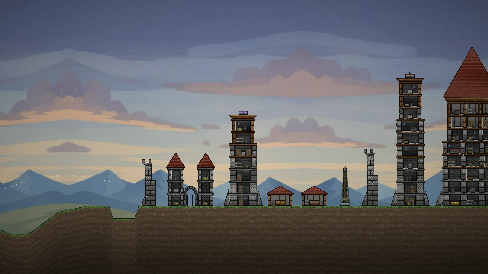

**[▶ Play in your browser](https://cktang88.github.io/siege-game/)**

A 2D side-view physics siege game. You plan an armament within a budget, then bring a fortress down while it fights back.

Built with Vite, TypeScript, Three.js (orthographic camera, custom cel-shading GLSL, bloom) and Rapier2D physics.
The concept notes are in `docs/`.

```bash
npm install
npm run dev      # http://localhost:5173
npm run build    # type-check and production build into dist/
```

## Screenshots

### Castles

Every fortress stands on its own hill, so most shots go level or upward. Only the infantry and vehicles come down into the valley between.

| | |
|---|---|
| 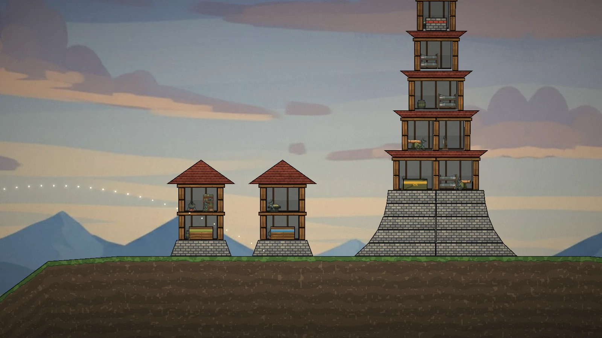 | 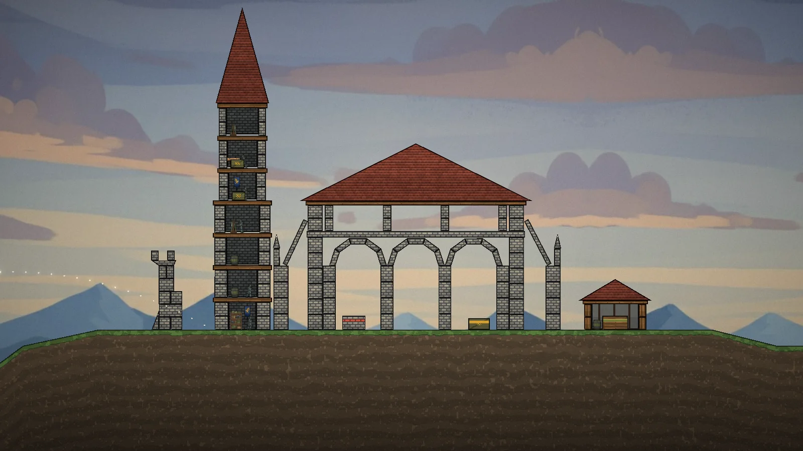 |
| **Kurogane**: a tiered Japanese keep with sloped tile roofs and corner yagura on a stone base. | **St. Aldric's Abbey**: an arcade held up by flying buttresses, next to a spired bell tower. |
| 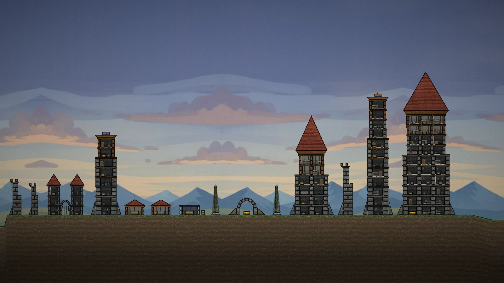 | 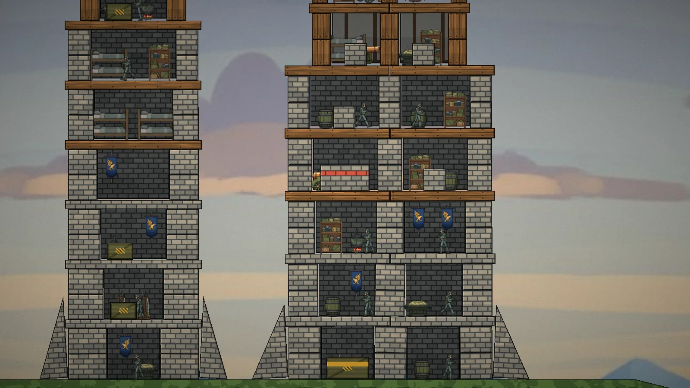 |
| **The Black Citadel**: the final fortress, with dozens of rooms across its towers and keep. | **Garrison**: the keeps are shown in cutaway. People and furniture fill the rooms, and they flee when fire breaks out. |

### In battle

| | |
|---|---|
| 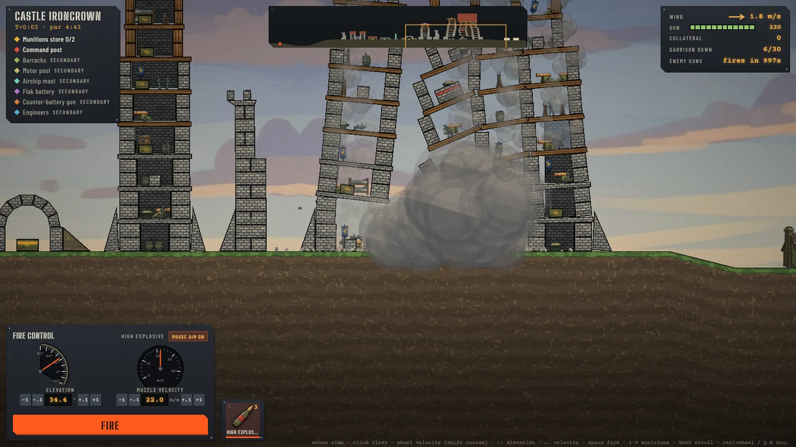 | 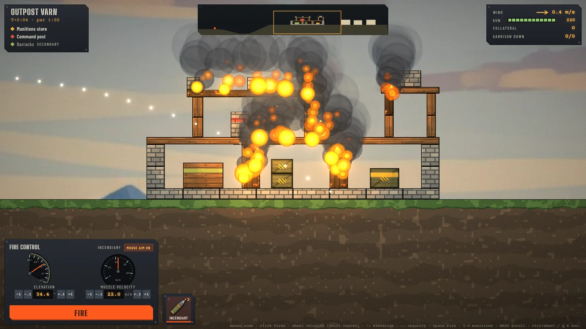 |
| **Load-bearing structures**: knock out the columns and the floors above come down. | **Fire** spreads from timber to nearby timber, and fuel stores chain-explode. |
| 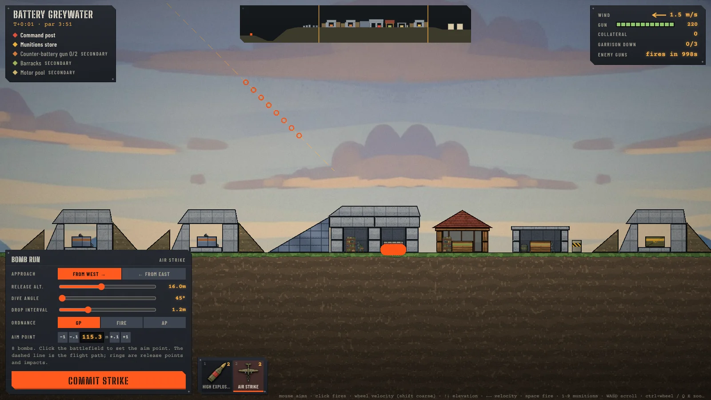 | 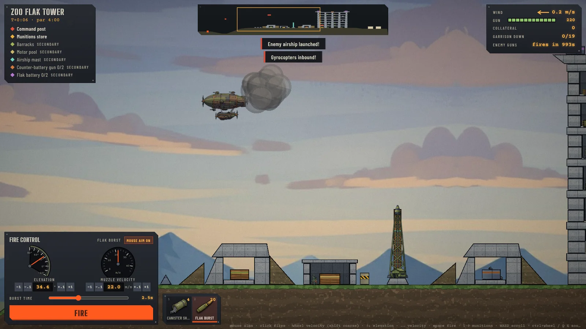 |
| **Air strikes**: set the approach, release altitude, dive angle, bomb spacing and aim point. | **Enemy air**: airships and gyrocopters come for your gun. Flak bursts bring them down. |
| 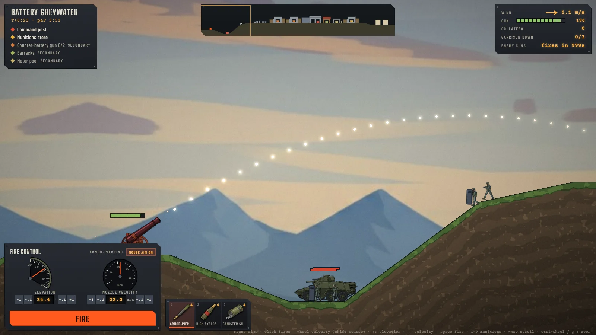 | 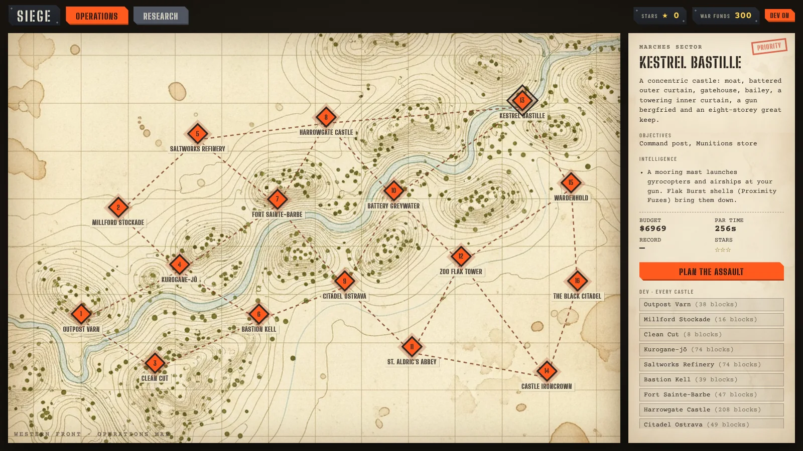 |
| **Vehicles and shield troops** advance across the valley in later operations. | **Operations map**: each cleared operation opens neighbouring ones. |
| 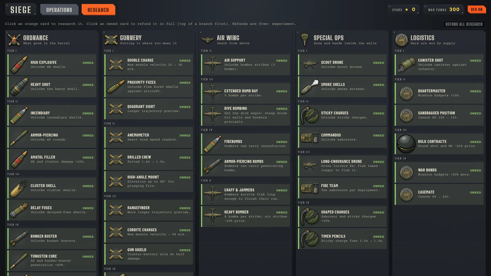 | 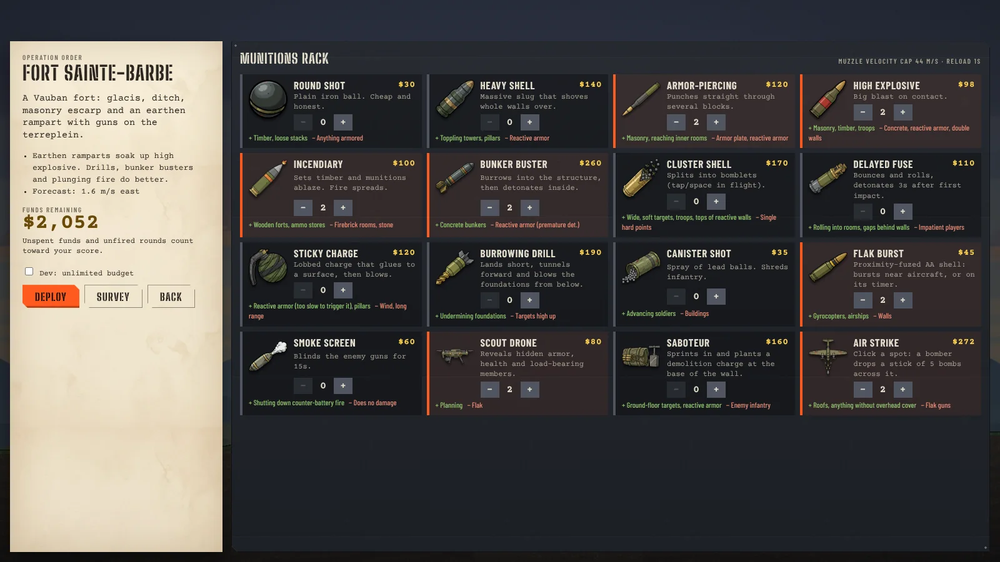 |
| **Research**: five branches of upgrades, refundable at any time. | **Armory**: buy rounds within the mission budget. Hold a button to buy repeatedly. |

## How to play

1. **Operations map.** Each cleared operation opens one or two neighbouring ones, so a few are always available. Some deep operations also need a total star count. Select a node to read its dossier.
2. **Research.** War funds come from missions: a first clear, each new star, and any score above your previous best pay out. Replaying for the same result pays nothing; a failed attempt pays a little salvage for objectives knocked out beyond your best previous attempt. Spend them across five branches: Ordnance, Gunnery, Air Wing, Special Ops and Logistics. Research unlocks munitions and upgrades muzzle velocity, reload, elevation, trajectory preview, wind readout, gun armour, bomb loads, dive bombing, bomb types, drone endurance, saboteur teams and budgets. Click an owned card to refund it (the top of a branch first), or refund everything at once. Refunds are free.
3. **Armory.** Buy rounds within the mission budget. Unspent money and unfired rounds count toward your score. **Survey** lets you hover blocks to read their material and HP.
4. **Battle.** Every shot is fully controllable:
   - **Gun:** set elevation (degrees) and muzzle velocity (m/s). The barrel follows the mouse over the battlefield and a click fires. How far the cursor is from the gun sets muzzle velocity: right by the gun is the slowest charge, about 60% of the screen width away (a setting) is full charge, and a readout by the cursor shows velocity and elevation. Hold Shift to keep the velocity while you change only the elevation; the mouse wheel trims velocity on top of the distance (Shift+wheel in coarse steps). You can also drag the needles on the quadrant and gauge, type exact values, or step by ±0.1 / ±1. Arrow keys adjust too (hold Shift for fine steps). `T` (or the *Mouse aim* switch) turns mouse aiming off when you want typed values to stay put. The delayed fuse and the cluster airburst have their own timers.
   - **Air strike:** set the approach (from west or east), release altitude, dive angle (needs Dive Bombing research), drop interval and ordnance (GP, firebombs or AP bombs). Click the field to set the aim point. The bomb run is solved against gravity and wind, and the preview draws the flight path, release points and predicted impacts. Fly too low or too steep and the bomber hits the ground.
   - **Drone and saboteur:** click the field to choose where the drone loiters or where the team plants its charge.
5. **Win** by destroying every ◆ objective. Stars come from time against par, budget left over, secondary targets, gun condition and collateral damage.

**Settings** (the *Settings* button on the operations map, or *Menu* → *Settings* in battle) are stored in this browser under their own key (`siege-settings-v1`), apart from the campaign save, and apply at once:

| Setting | What it does |
|---|---|
| Master / Music / Effects volume | levels of the master, music and effects sound buses |
| Mute all | silences everything (`M` toggles it in battle) |
| Mouse aim | whether the barrel follows the cursor when a battle starts (`T` still toggles it in battle) |
| Distance sets velocity | on: the cursor's distance from the gun sets muzzle velocity; off: the mouse sets elevation only, and velocity comes from the wheel, ← → or the dial |
| Full-charge distance | how far from the gun, as a share of the screen width (25–90%, default 60%), the cursor gives a full charge |
| Trajectory dots | shows or hides the preview arc in front of the gun |
| Pan speed | WASD scrolling speed (0.4–2.5×) |
| Screen shake | 0–150% of the shake from the gun and from blasts |
| Effects quality | High: full particle pools, bloom, pixel ratio up to 2. Medium: 60% pools, bloom, up to 1.5. Low: 35% pools, no bloom, 1×, coarser fire and smoke fields |
| UI scale | 90%, 100% or 115% for the plates, panels and screens |
| Controls line | the one-line key reminder along the bottom of the battle screen |
| Reset progress | wipes stars, records, war funds and research (press twice to confirm); settings are kept |

**Dev mode:** the `Dev` button on the map, the switch on the settings page, or `?dev` in the URL turns it on for the current browser tab only. It is never written to the save, and a battle begun in dev mode pays no funds, records no stars and is marked *dev · not scored* in the after-action report, even if dev mode is switched off during it. In dev mode:

- every castle and every technology are open;
- the armory issues a **sandbox rack**: every munition, researched or not, unlimited (∞) and free. The rack never runs down. Untick *sandbox rack* to buy rounds as normal (optionally with an unlimited budget);
- a **castle picker** (*Castles* in the top bar) lists every campaign operation, the off-campaign themed fortresses, 12 seeded proving grounds and 4 grand proving grounds, and generates new ones from a generator (fortress or grand), theme, seed and difficulty;
- a **dev sandbox panel** in battle (`` ` `` folds it) spawns enemy infantry, shield infantry, armoured cars, light tanks, gyrocopters and airships, ×1, ×5 or ×10 at a time, at the foot of the fortress (aircraft over it). Switches: *Freeze enemy* (no counter-battery fire, reinforcements, repairs, air raids or motor-pool sorties), *God-mode gun*, *Instant reload*, *Slow-mo ¼*, plus *Reveal rooms* (opens every concealed room) and *Clear field*. The only limit is a frame-time guard of 300 infantry, 80 vehicles and 80 aircraft alive at once (units are sprites, not physics bodies; only their shells and bombs are).

Keys: `Space` fires (or triggers the in-flight special), `1`–`9` pick a munition, the mouse wheel sets velocity (zooms outside battle), `Ctrl`+wheel or `Q`/`E` zoom, any drag pans, `WASD` scrolls, `R` resets the view, `T` toggles mouse aim, `M` mutes and `Esc` (or the *Menu* button) halts the battle behind a menu: *Resume*, *Settings*, *Withdraw* (press twice). The *Withdraw* button on the objectives plate also abandons the attack when pressed twice. In dev mode `` ` `` folds the sandbox panel. Click an objective in the list, or an objective marker pinned to the screen edge, to look at it. Shortcuts are ignored while you type in a number field.

## Munitions (15)

| Round | Use it for | Countered by |
|---|---|---|
| Round Shot | cheap knockdowns | armor |
| Heavy Shell | shoving pillars and towers over | reactive armor |
| Armor-Piercing | punching through several masonry blocks to inner rooms | armor plate, reactive armor |
| High Explosive | masonry, timber, troops | concrete, double walls (blast is occluded by the first wall) |
| Incendiary | timber forts and munitions stores; fire spreads | firebrick vaults |
| Bunker Buster | penetrating concrete, then detonating inside | reactive armor (premature detonation) |
| Cluster Shell | scatters bomblets: tap in flight, or set an airburst timer | single hard points |
| Delayed Fuse | bouncing or rolling into rooms; blows 3 s after impact | — |
| Sticky Charge | gluing onto pillars; too slow to set off reactive armor | wind |
| Burrowing Drill | landing short and tunnelling up to 12 m under the walls: it blows beneath the first target it reaches (or under the last wall it passed) | high targets |
| Canister Shot | shredding infantry | buildings |
| Smoke Screen | blinding the counter-battery guns for 15 s | — |
| Scout Drone | opening walled-up rooms along its flight path, revealing disguised armor and load-bearing members | flak |
| Saboteur | running in to tamp a demolition charge against the wall base (casemates, reactive walls) | enemy infantry |
| Air Strike | a planned bomb run: heading, altitude, dive, interval, ordnance | flak (bombs released within its reach scatter; it downs the bomber) |

Castles stand on hills, 3.5–11 m above the plain depending on the operation (star forts hug the ground), so most shots go level or upward; the gun is re-placed per level so every objective stays in range at the muzzle velocity you're expected to have there. Your gun sits on a raised earthen redoubt, about 3.5 m up. Elevation goes down to −30°, so you can fire down on infantry that halt at the foot of the slope. Canister pellets each pass through up to two men, and solid shot (round shot, heavy shell) ploughs through a whole file. In the armory, press and hold + or − to keep buying or selling.

`BASE=http://127.0.0.1:5173 node scripts/munition-lab.cjs [test or munition ids]` (Playwright, dev server running) sets up a small lab scenario for every munition and counter above, fires it, steps the simulation and prints a PASS/FAIL table of each claim with the measured numbers.

`BASE=http://127.0.0.1:5173 node scripts/ui-flow.cjs [sections]` plays the campaign loop and the screens around it headless (research, armory, battle, rewards and salvage, star gates, corrupt saves, blocked storage, settings, dev mode, the castle picker, input, window sizes, listener and DOM leaks, audio) and checks the UI's invariants; with `SHOTS=dir` it also screenshots every screen at 1280×720, 1920×1080 and 900×600.

## The enemy fights back

- **Mooring masts:** launch Storm Winds-style air raids: weaving gyrocopter gunships that strafe your gun, and armoured airships that bomb it. Shot-down aircraft fall burning and crash, onto the castle if they're over it. Answer them with **Flak Burst** shells (research *Proximity Fuzes*), which burst when an aircraft comes near or on a timer you set. Canister and other rounds hit them too.
- **Garrison:** soldiers live in the rooms among era-appropriate furniture: banners, bunks, weapon racks, cauldrons, war tables and field radios. They stroll, stand about, squat by the furniture and climb ladders between storeys (never into a room that has failed or is burning). They ride their floors, fall when a room fails, and die to blasts, falling masonry, long falls and fire. Casualties are scored.
- **Concealed rooms:** from the middle of the campaign some rooms are walled up (about a quarter of them, about 40% in the late castles; fixed per castle). The cutaway shows the surrounding masonry, timber or concrete, so whatever is inside is hidden. That includes people, stores and sometimes an objective, which the objectives list then marks *location unknown*. You can still fire at it blind. A scout drone sees into walled-up rooms below and around it. A destroyed or displaced block of the room's frame, an explosion inside it, or a fire in it also breaks the room open. Hidden people are left out of the garrison count (shown as `+?`), and neither the minimap nor the Survey tooltip shows what is inside.

- **Counter-battery gun:** fires at your cannon, with each shot landing closer (bracketing). Silence it or blind it with smoke.
- **Barracks:** sends infantry at your gun. Destroy it to stop reinforcements.
- **Shield infantry** (later operations, difficulty 4+): part of each draft carries a pavise or a steel ballistic shield facing your gun. The shield stops canister pellets and round shot from the front (a heavy shell still knocks the man flat, and enough hits wreck the shield). Explosions, fire, cluster bomblets, flak bursts overhead, plunging fire and anything from behind still kill them. They walk a little slower.
- **Motor pool:** sends vehicles from the front of the fortress until destroyed. They halt on the valley floor short of your redoubt and queue behind each other; a knocked-out vehicle burns as a wreck.
  - *Armoured car:* fast, strafes your gun with a turret MG (small, steady damage). Canister bounces off and solid shot barely dents it; one AP round, two HE hits, a sticky charge, a drill under it or a bomb kills it.
  - *Light tank* (Zoo Flak Tower onward): slow, heavier armour with a long sloped glacis that glances flat AP and shot. Its main gun shells your gun every 6–8 s, walking its fall of shot in. Plunge AP onto it (two hits), stick two charges on it, or use bunker busters and AP bombs. Smoke blinds it.
- **Engineers:** one crew patches one cracked block at a time, working from the bottom of the castle up (about 30 s for a badly cracked block). They can't mend blocks that are burning, knocked loose or shattered, and they never rebuild what you destroyed. Knock out the engineers' workshop to stop them.
- **Flak:** shoots down bombers and drones. A bomber that releases within a flak gun's reach (about 48 m) has its stick thrown off the aim point, so fly high over defended targets.
- **Munitions store:** detonates in a chain reaction when destroyed or burned.

## Structures

Every block is a Rapier rigid body with a material (timber, masonry, reinforced concrete, armor plate, reactive armor, firebrick, munitions). Each material has its own HP, density and modifiers against kinetic, blast, fire and penetration damage. Fortresses stand on real support, so taking out a load-bearing column drops whatever it holds up. Falling debris deals impact damage, explosions are occluded by intervening walls, and some armor is disguised until you scout it.

Fire works by heat. A burning block burns through its fuel over about 6 to 28 s, depending on material and size, and chars as it goes. A timber member usually gives way near the end of its burn. Flammable blocks within 0.4 m of a fire can catch. The chance depends on the gap, the length of the shared face, the material and the wind. Flames climb, so a block above a fire catches about 3.5 times as readily as one beside it, and one below catches rarely, unless burning wreckage drops onto it. Masonry, concrete, steel, tile and firebrick never burn, and they also block the heat, so a stone wall stops a fire and a firebrick vault keeps its contents safe. Burning blocks that break up throw embers. Furniture in a burning room catches and carries the fire to the rest of the room. People on upper floors are trapped and may die; people on a ground floor run out. A fuel tank that catches fire, or is holed below about 45% HP, cooks off a couple of seconds later and sets the next tank alight.

## Castles and structures

Blocks can be any convex polygon: wedges, trapezoids, roofs, rotated beams and arch voussoirs. Slope matters:

- Shells and penetrators lose effectiveness as 1/cos(obliquity).
- Past the critical angle they ricochet: steel at ~56°, concrete at ~65°.
- Low, flat shots skip off a sloped glacis. High plunging fire, air-dropped AP bombs or bunker busters get through.

Materials include earthworks (soak up blast), clay roof tiles, plaster over timber (burns) and volatile fuel tanks (chain-explode).

Castles are built tall rather than deep, and each stops at its keep so every objective is in range. The gun is placed per level so every target is reachable, against the worst headwind, by the muzzle velocity the player can have at that point of the campaign: 30 m/s for the open operations, 36 m/s (Double Charge) behind the first star gates, 44 m/s (Cordite Charges) for Ironcrown, Wardenhold and the Black Citadel. `node scripts/level-stability.cjs` (with the dev server on port 5184) loads every level, lets it stand for 10 s and lists anything that moved. Columns thin with height, as bergfried and donjon walls do, and keeps step narrower above about 60% of their height, like butter-churn towers. Slender bergfrieds rise 8–12 storeys under guns or spires.

Real-structure archetypes live in `src/archetypes.ts`. Proportions and sources are in `docs/RESEARCH.md`.

| Operation | Built from |
|---|---|
| Kurogane-jō | ishigaki fan-slope stone base, five-tier tenshu (each tier ~80% of the one below) with flared tile eaves, yagura turrets |
| Saltworks Refinery | fuel tanks, pipe racks, cracking column, brick stack, concrete-arch airship hangar with a cigar-shaped airship |
| Fort Sainte-Barbe | glacis, ditch, masonry escarp, earth rampart and parapet, buried vaulted magazine |
| St. Aldric's Abbey | arcade of arches, end buttresses, flying buttresses on pinnacled piers, bell-tower spire |
| Battery Greywater | dragon's teeth, hedgehogs, Regelbau casemates under earth berms, steel-glacis command bunker |
| Harrowgate Castle | moat, battered curtains with machicolations, twin-towered gatehouse with arch and portcullis, hoarded tower keep |
| Zoo Flak Tower | a squat four-bay, seven-storey concrete frame (the real tower was ~70 m square, ~39 m tall) with cantilevered corner gun tubs |
| Kestrel Bastille | concentric castle with moat, gatehouse, bailey, inner curtain, gun towers and a five-storey great keep (47 rooms) |
| Wardenhold | obstacle belts, casemates, earth rampart, flak tower, armoured bunker and refinery (24 rooms) |

There are also 4 hand-built fortresses and a seeded modular generator (`src/fortgen.ts`).

### Great fortresses

The late campaign (Kestrel Bastille, Castle Ironcrown, Wardenhold, The Black Citadel) uses `src/grandgen.ts`. These castles have 40 to 84 rooms each. Each one has:

- a curtain wall (double at high difficulty, with a disguised reactive skirt)
- a gatehouse and a bailey with barracks and workshops
- an inner curtain
- gun towers
- one or two multi-storey keeps

Every building is a post-and-lintel grid. Each room's floor slab spans from the centre of one column to the centre of the next, so knocking out a column lets the floors above fold down storey by storey. Rooms have cutaway back walls that crumble once their frame fails.

On castles this size the overview covers the gun and the near works. To see the rest, use the minimap (click or drag it), Ctrl+wheel or Q/E to zoom, or drag the field.

## Look and sound

The rendering techniques are ported from [tinwar](https://github.com/cktang88/tinwar) onto three.js:

- every blast, muzzle flash, tracer and fire is a short-lived point light with cel-stepped falloff
- selective bloom, a colour grade, animated grain, and a chromatic split on big hits

Infantry use a cut-out rig: the upper body is segmented from the generated sprite, and the rigged legs follow a gait driven by distance moved.

All sound is procedural WebAudio, in tinwar's recipe style: layered tone and noise sweeps through a glue compressor and limiter, with distance falloff and pan. A small D-minor march score builds with the fighting.

## Art

Sprites, the backdrop, the operations map, textures, branch insignia and munition icons are toon cel-shaded images generated through OpenRouter (`google/gemini-2.5-flash-image`):

```bash
OPENROUTER_API_KEY=... node scripts/gen-sprites.mjs [name ...]   # world sprites → public/sprites/raw/
python3 scripts/process-sprites.py                               # key, trim, downscale → public/sprites/
OPENROUTER_API_KEY=... node scripts/gen-ui.mjs [name ...]        # UI art → public/ui/raw/
python3 scripts/process-ui.py                                    # border-sampled flood-fill key, despill → public/ui/
```

Blocks, terrain, particles, debris and soldier legs are drawn procedurally. Research notes and sources are in `docs/RESEARCH.md`.
